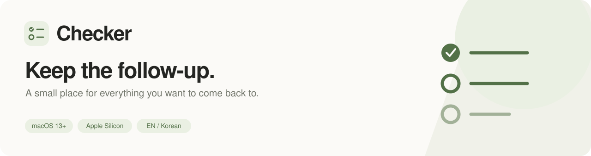
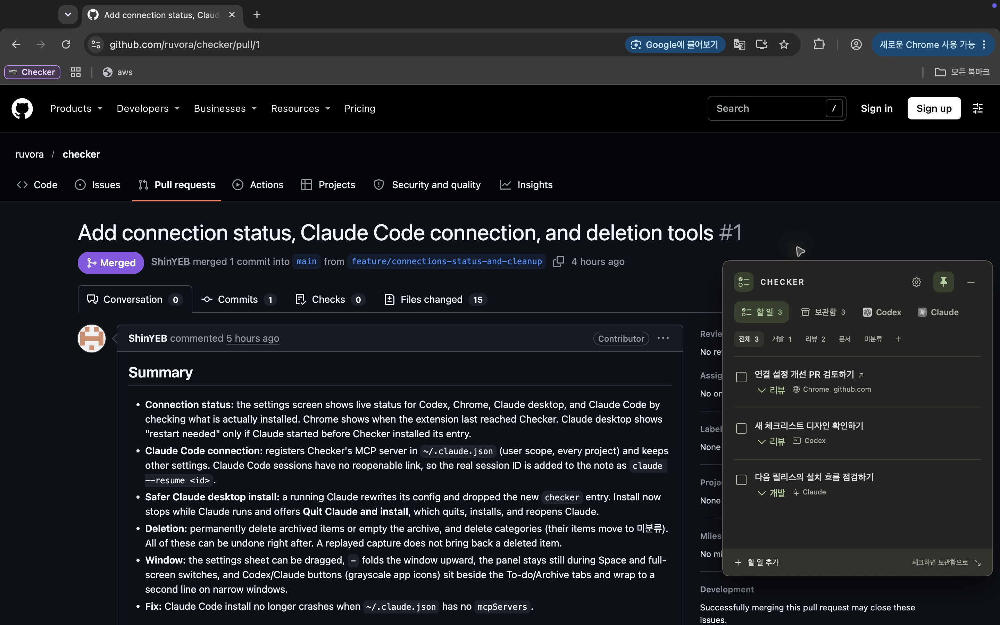
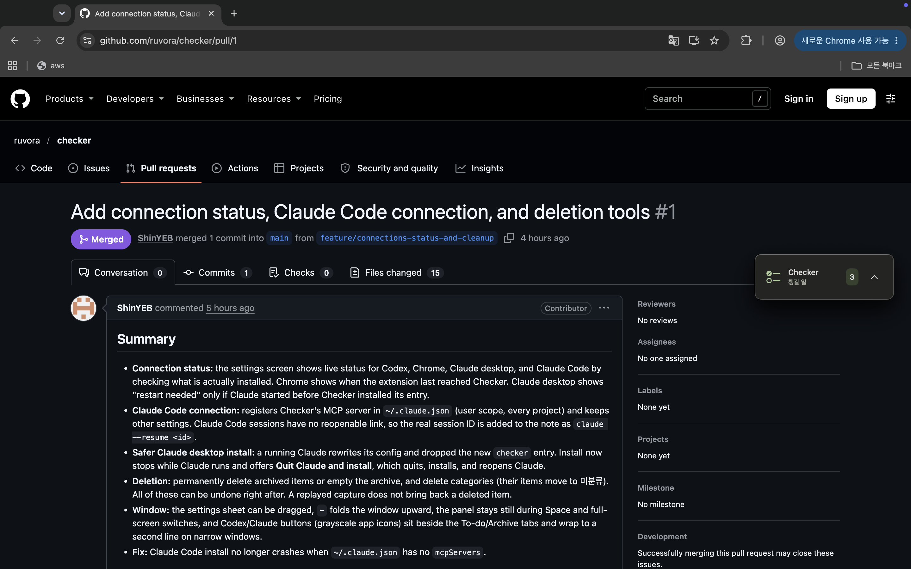
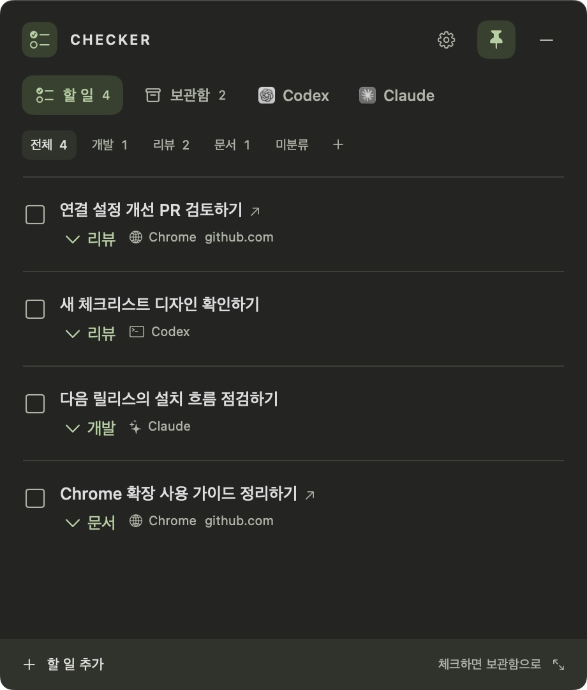
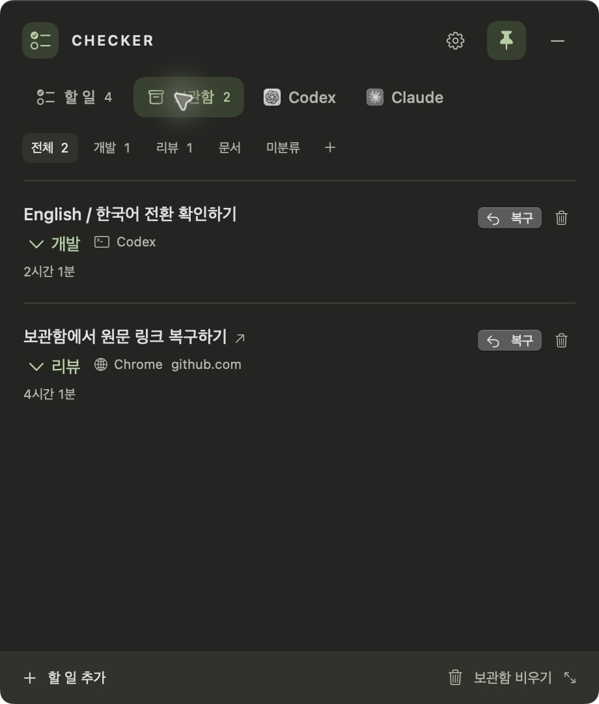

<p align="center">
  
</p>

<p align="center">
  <strong>도구를 옮겨 다녀도, 챙길 일은 한곳에.</strong><br>
  Codex · Claude · Chrome에서 남은 일을 모아두는 작은 macOS 체크리스트.
</p>

<p align="center">
  <a href="https://github.com/ruvora/checker/releases">설치 파일 다운로드</a> ·
  <a href="INSTALL.md">AI에게 설치 맡기기</a> ·
  <a href="#도구-연결">도구 연결</a> ·
  <a href="docs/DEVELOPMENT.md">개발 가이드</a>
</p>

## “이건 나중에 봐야지”를 놓치지 않도록

AI가 끝낸 작업의 결과, 다시 읽어볼 PR, 문서에서 발견한 후속 작업. Checker는 여러 곳에서 생긴 일을 화면 위 작은 창에 모아둡니다. 작업을 마친 뒤 AI에게 추가를 요청하거나, Chrome에서 **추가하기**를 누르면 됩니다.

| PR을 보면서 목록 확인 | 집중할 때는 작은 배지로 |
| :---: | :---: |
|  |  |
| 다른 앱 위에 띄워두고, 다시 확인할 일 챙기기 | 목록을 접어두고 남은 개수만 보기 |

이미지를 누르면 크게 볼 수 있습니다.

<details>
<summary>할 일 목록과 보관함 자세히 보기</summary>

| 할 일을 한눈에 | 끝낸 일은 보관함으로 |
| :---: | :---: |
|  |  |
| 출처와 카테고리를 함께 보고, 제목으로 원문 열기 | 한 번 눌러 보관하고, 필요할 때 복구하기 |

</details>

<p align="center"><sub>실제 앱 화면 · 촬영용 예시 데이터<br>화면과 기능 설명은 main 브랜치 기준으로, 배포된 설치 파일과 일부 차이가 있을 수 있습니다.</sub></p>

## 작게 띄워두고, 가볍게 챙기세요

| 기능 | 이렇게 사용해요 |
| --- | --- |
| **화면 위에 고정** | 다른 앱을 사용해도 보이도록 고정하고, 드래그로 위치와 크기를 바꿉니다. |
| **작은 배지로 접기** | `−`를 누르면 남은 일의 개수만 보이는 배지로 접힙니다. |
| **AI로 간편하게 추가** | Chrome은 화면·본문을 분석하고, Codex·Claude는 작업 맥락을 바탕으로 제목·메모·카테고리를 정합니다. |
| **원문으로 돌아가기** | 저장된 링크가 있는 제목을 누르면 해당 대화나 웹페이지로 이동합니다. |
| **자동 분류와 직접 분류** | 기존 카테고리에서 AI가 고르고, 앱에서 수정하거나 새 카테고리를 만들 수 있습니다. |
| **보관·복구·정리** | 체크하면 보관함으로 이동합니다. 보관한 항목과 카테고리는 삭제할 수 있고, 삭제 직후 되돌릴 수 있습니다. |
| **English / 한국어** | 앱·확장·새 AI 결과의 언어를 함께 바꿉니다. 기존 제목·메모와 직접 만든 카테고리 이름은 유지합니다. |

## 시작하기

지원 환경은 **macOS 13 이상 · Apple Silicon(M1 이상)** 입니다. 설치 파일에는 Python 실행 환경이 포함되어 있어 개발 도구를 따로 설치할 필요가 없습니다.

### AI에게 설치 맡기기

로컬 명령을 실행할 수 있는 AI에게 아래 문구를 전달하세요.

```text
이 안내에 따라 Checker를 설치해줘:
https://raw.githubusercontent.com/ruvora/checker/main/INSTALL.md
```

AI가 다운로드·검증·앱 복사까지 진행합니다. 앱을 연 뒤 **연결 설정 → 선택한 연결 설치**로 사용할 도구를 연결합니다. 같은 버전은 재설치하지 않습니다. [자세한 안내와 영어 요청 문구 →](INSTALL.md)

### 직접 설치하기

1. [GitHub Releases](https://github.com/ruvora/checker/releases)에서 `.dmg`를 내려받습니다.
2. Checker를 **Applications(응용 프로그램)** 폴더로 옮기고 실행합니다.
3. 처음 열리는 **연결 설정**에서 사용할 도구를 선택하고 **선택한 연결 설치**를 누릅니다.

Chrome 확장은 아직 웹 스토어에 등록하지 않아 개발자 모드로 한 번 추가해야 합니다. Chrome의 AI 화면 분석에는 **Codex 앱 설치와 로그인**이 필요합니다. 설정은 앱 위쪽 톱니바퀴에서 다시 열 수 있습니다.

현재 설치 파일은 **Developer ID 서명·Apple 공증이 없는 테스트 배포판**입니다. 최초 실행 시 개발자 확인 경고가 나타날 수 있습니다. 디스크 이미지에 한국어·영어 설치 안내가 들어 있습니다. 앱을 교체해도 기존 목록과 보관함은 남습니다.

## 도구 연결

| 도구 | 추가하는 방법 | 원문으로 돌아가기 |
| --- | --- | --- |
| **Codex** | 새 대화에서 `$checker-capture`로 “이 결과를 나중에 확인하게 추가해줘”라고 요청 | 실제 대화 ID가 제공되면 해당 Codex 대화 링크 저장 |
| **Claude 데스크톱** | 연결 설정 후 Claude를 다시 열고 `checker` 도구 사용 | 실제 대화 링크를 함께 제공하면 저장 |
| **Claude Code** | 연결 설정에서 선택한 뒤 새 세션에서 `checker` 도구 사용 | 열 수 있는 대화 링크 대신, 실제 세션 ID가 환경 변수로 제공되면 복귀 명령을 메모에 저장 |
| **Chrome / Claude 웹** | Checker 확장을 열고 **추가하기** 한 번 | 현재 페이지 URL을 그대로 저장 |

**Chrome 확장 설치:** `chrome://extensions` → 개발자 모드 → **압축해제된 확장 프로그램을 로드합니다** → Checker 연결 설정의 **확장 폴더 열기 / 폴더 경로 복사**로 확인한 폴더를 선택합니다. 이미 설치했다면 확장을 새로고침하세요.

Claude 데스크톱이 실행 중이면 **Claude 종료 후 설치**로 연결하고 다시 엽니다. 진행 중인 작업은 먼저 저장하세요. 대화 링크가 제공되지 않은 항목은 링크 없이 저장합니다. 연결 설정에서 각 도구의 설치 상태와 Chrome의 마지막 연결 시간을 확인할 수 있습니다.

[연결 경로·MCP·스킬 동작 자세히 보기 →](docs/DEVELOPMENT.md#codex--claude--chrome-연결)

## 데이터와 AI

체크리스트·보관함·설정은 `~/Library/Application Support/Checker/`에 저장합니다. 별도 Checker 서버나 API 키는 필요하지 않습니다.

Chrome의 AI 분석은 **현재 탭의 화면 이미지·본문·선택 문장을 로그인된 Codex 계정으로 전송**하며, 해당 계정의 사용 한도를 사용합니다. 팝업을 닫아도 분석을 계속하고, 완료 후 목록에 추가합니다. 분석용 본문·이미지 임시 파일은 처리가 끝나면 삭제합니다.

## 개발하기

SwiftUI · AppKit · Python · Chrome Native Messaging / MCP로 구성되어 있습니다. 소스에서 실행하려면 macOS 13 이상, Apple Command Line Tools(Swift), Python 3이 필요합니다.

```sh
./scripts/build.sh
open build/Checker.app
```

```sh
./scripts/test.sh
```

[개발 가이드](docs/DEVELOPMENT.md)에서 연결 설치, 저장 구조, 확장 검사, 실제 AI 검사, 배포용 설치 파일 생성 방법을 확인하세요. Intel Mac·Windows 패키지와 Chrome 웹 스토어 배포는 아직 지원하지 않습니다.
