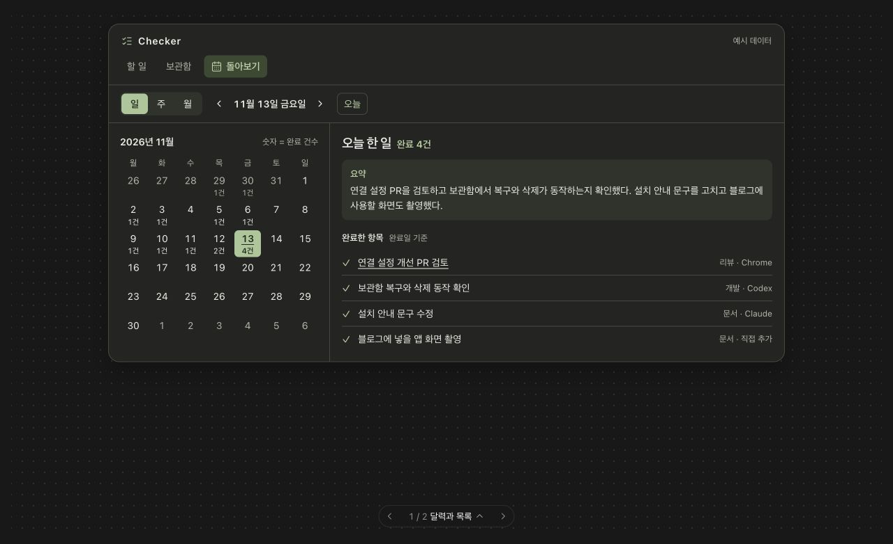
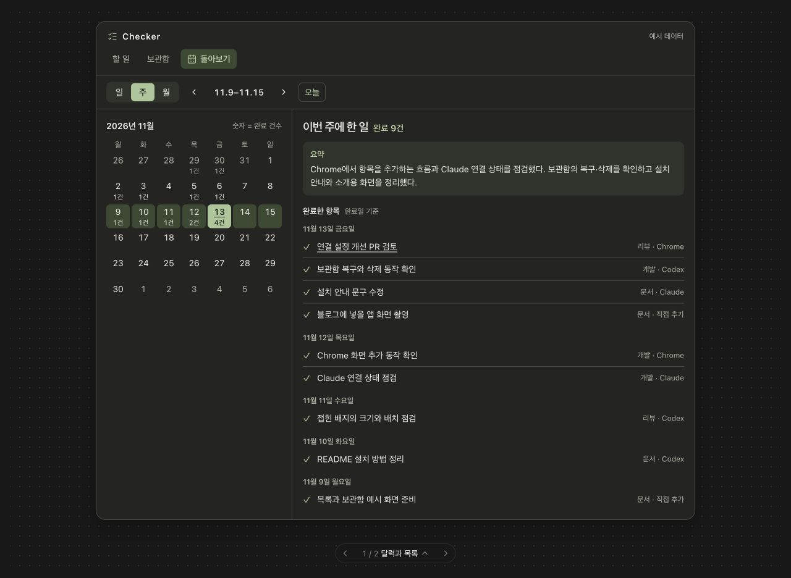
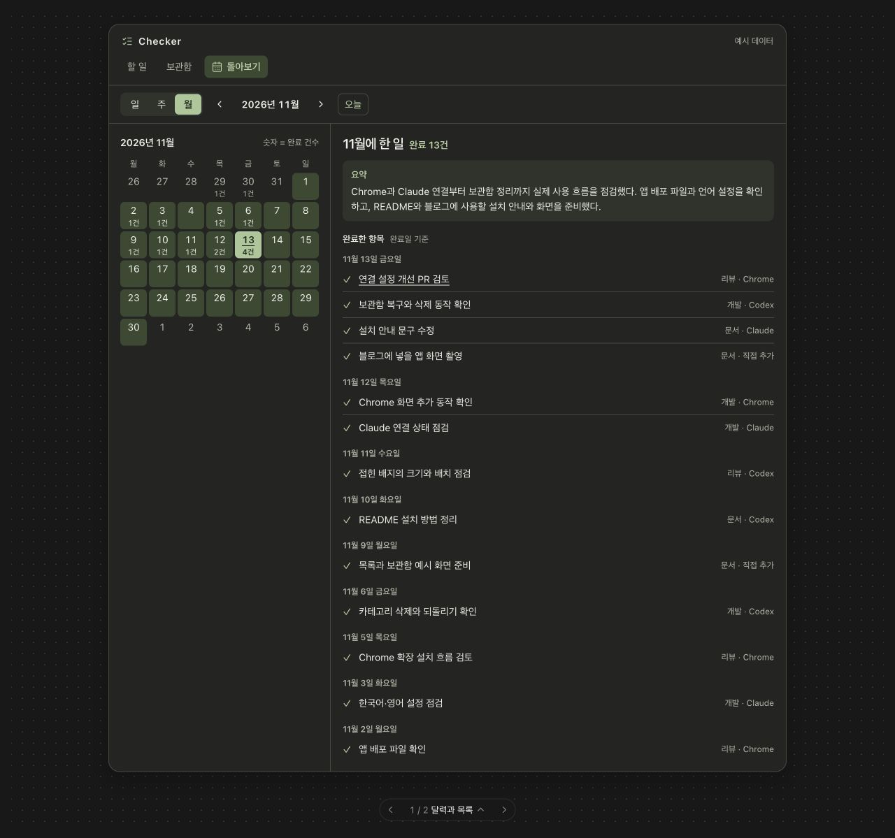
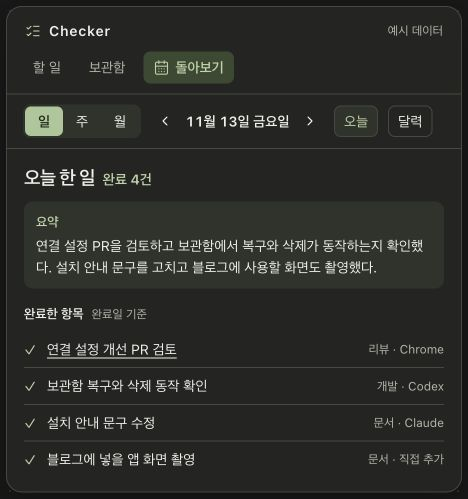
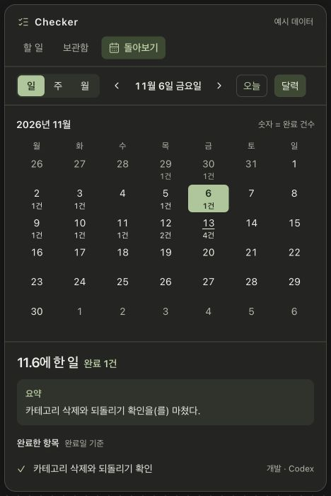
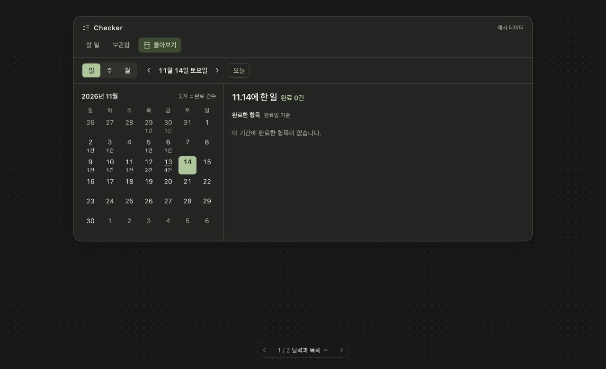

# Checker 돌아보기 디자인 시안

달력에서 날짜를 고르고 일·주·월을 선택하면, 해당 기간에 완료한 항목의 요약과 목록을 함께 보는 화면입니다. 아래 캡처는 예시 데이터로 만든 시안입니다.

- [일간](#일간) · [주간](#주간) · [월간](#월간)
- [작은 창](#작은-창) · [작은 창에서 달력 펼치기](#작은-창에서-달력-펼치기) · [완료한 항목이 없는 날](#완료한-항목이-없는-날)

## 일간

11월 13일에 완료한 4건의 요약과 항목별 제목, 분류, 출처를 보여줍니다.

## 주간

11월 9일부터 15일까지 완료한 9건을 날짜별로 묶습니다. 달력에서 해당 주 전체를 강조합니다.

## 월간

11월에 완료한 13건을 한 달 요약과 함께 보여줍니다. 목록 마지막 항목까지 캡처했습니다.

## 작은 창

기존 Checker 창 크기에서도 일·주·월을 바꾸며 요약과 목록을 볼 수 있는 안입니다.

## 작은 창에서 달력 펼치기

`달력`을 누르면 날짜를 고를 수 있습니다. 이 예시에서는 완료 항목이 1건인 11월 6일이 선택되어 있습니다.

## 완료한 항목이 없는 날

선택한 날짜의 완료 건수를 0건으로 표시하고 목록 영역에 안내를 보여줍니다.

[Checker README로 돌아가기](../README.md)
